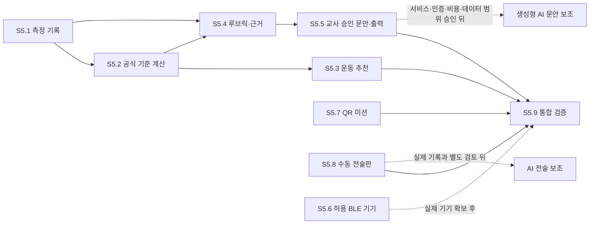

# S5 구현 계획: PAPS·과정평가·확장 모듈

상태: S5.1~S5.5, S5.7~S5.8의 로컬 개발 기능과 S5.9 자동 검증 완료. 2026-11-07 현재 S5.6은 PWA v2와 Android 태블릿 호스트 소스를 추가했다. Android 앱은 출처 제한 Web Message 브리지, TLS WebSocket 수신기, 일회용 초대, 메모리 전용 심박 전달을 포함한다. 2026-11-07 사용자 승인 뒤 Android SDK Platform 35 환경에서 debug APK 빌드·JVM 검사·Lint(0 오류·0 경고)를 통과했다. 학생 companion, 기종·OS 지원표, 실기기 연결은 아직 구현/검증되지 않았다. 사용자는 학생별 페어링 휴대폰 → 같은 로컬 Wi-Fi → Android 교사 태블릿 경로를 선택했다. 학교 현장·발열·실제 40분 지속 검증은 이번 작업에서 제외했다. 자세한 근거·한계는 [S5.3~S5.9 검증 기록](stage-S5.3-S5.9-validation.md), [웨어러블 검증](stage-S5.6-wearable-validation.md), [공식 API 조사](stage-S5.6-vendor-api-research.md), [LAN 릴레이 계약](S5.6-lan-relay-contract.md), [지원 환경표](S5-support-matrix.md)에 있다.

## 목표와 범위

첨부 「초등체육 에듀테크 및 앱 명세서」의 Fit-Track & PAPS, 운동 처방, Eval-Bridge & AI Scribe, Tactics & Bound Play 요구를 S3 학급·학생 식별자와 기존 PIN 암호화 저장 위에 순차 구현한다. 학생별 결과를 자동으로 채점·진단하거나 외부로 보내는 것을 기본값으로 삼지 않는다. 점수·평가 문구는 교사가 근거를 보고 수정·승인해야 한다.

문서에 제시된 1초 산출, 행정업무 80% 감소, 500개 콘텐츠 같은 수치는 달성 사실이 아니다. 구현 목표·효과 주장으로 쓰기 전 실제 업무와 자료를 이용해 따로 측정한다. 실제 NEIS 양식·PAPS 기준표·웨어러블 규격이 없는 경우 임의의 공식 기준이나 연동 완료를 주장하지 않는다.

## 의존 관계와 우선 순서

기본 순서는 S5.1 → S5.2 → S5.4 → S5.5다. S5.3의 자체 텍스트 루틴은 공식 기준과 연결하지 않는 교사 선택형 MVP로 구현했다. 기록된 PAPS 약점 자동 추론이나 개인 건강 처방은 제공하지 않는다. S5.7은 QR 전용 로컬 MVP로 독립 진행할 수 있다. S5.6은 공식 API 경로와 LAN 데이터 계약을 정리하고 Android 태블릿 호스트 APK까지 빌드했다. 모델·OS 지원표, 학생 companion 앱, 실물 LAN/기기 시험이 남아 있다. S5.8은 수동 전술판을 먼저 만들고 AI 기능을 분리한다. S5.9는 각 묶음에서 소규모 통합 검사를 하고 전체 흐름을 마지막에 다시 확인한다.

## 단계별 구현 묶음과 완료 기준

### S5.1 — PAPS 수기 기록

**S5.1.1 데이터 계약 — 구현:** `measurements` 원자료에 학년도, S3 학생 ID, 측정일, 종목 ID, 값/단위, 입력 시각, 미수정 표시를 분리해 저장한다. S5.2에서 교사가 별표 4 적용 학년군·평가표 구분을 직접 확인한 경우에만 기준 버전을 함께 저장한다. 결측은 null 값과 사유로 표현하고 0과 혼동하지 않는다. 종합점수·건강 판정은 저장하거나 계산하지 않는다. 기록은 입력 학년도를 포함해 최대 3개 학년도 보관하고, 세 번째 후속 학년도 3월 1일에 만료한다. 기록이 유효한 동안 해당 S3 학생 ID/이름과 학급 이름도 암호화 상태로 유지하며 마지막 연결 기록 만료 또는 교사의 학급 삭제 때 정리한다. PAPS 자료는 기존 7일 클립 만료와 outbox/허브 전송 대상에서 분리했다.

**S5.1.2 교사 입력 — 구현:** 학급별 학생 ID 선택, 학년도/측정일, 5개 기본 수기 항목(왕복 오래달리기, 앉아 윗몸 앞으로 굽히기, 윗몸 말아 올리기, 제자리멀리뛰기, 악력)의 단위·기술 입력 범위·정밀도를 검사하고 다음 학생으로 이어 입력할 수 있게 했다. 미측정·결시·수행 불가·중단/거부·측정 오류·기타를 결측 이유로 제공한다. 현재 범위와 자릿수는 오입력 방지용 기술 한계이며 공식 PAPS 판정 기준이 아니다. 잘못 입력한 행은 PIN 안에서 개별 삭제 후 다시 입력할 수 있다. 음성 입력과 BLE 자동 입력은 후속 검증 뒤에 둔다.

**S5.1.3 변경·삭제 — 구현:** 교사가 값을 수정하면 이전 값·새 값·시각·교사 역할을 같은 PIN 암호화 기록에 추가하고 마지막 수정 시각을 갱신한다. 입력 시각은 보존한다. 학생 ID와 학년도는 수정할 수 없고, 잘못된 식별은 해당 기록을 지운 뒤 다시 입력한다. 개별 기록 삭제와 학급 삭제는 원값과 해당 수정 이력을 함께 제거한다. 학년도 만료도 nested history를 남기지 않는다. PIN 초기화는 IndexedDB의 클립과 암호화 학급 메타데이터를 새 PIN 설정과 한 트랜잭션에서 교체하며, 취소·실패는 기존 자료를 보존하고 성공하면 측정값과 수정 이력까지 지운다. 교사별 계정이 없는 현재 구조에서는 변경 주체를 `teacher` 역할로만 남긴다.

**현재 판정:** S5.1 전체 개발 구현·검증 완료. 실제 학교 자료·운영 정책 검토는 별도다. 공식 점수 계산은 S5.2에서 출처가 확인될 때까지 하지 않는다.

### S5.2 — 공식 PAPS 기준·계산·리포트

**S5.2.1 기준표 등록 — 구현:** 사용자가 제공한 공식 PDF의 별표 4에서 현재 입력 다섯 종목의 2026학년도 남녀·초3~고3 경계 100개를 등록했다. 항목은 출처 문서/해시/쪽수, 시행일, 학년도, 학년군, 단위, 대상 구분을 보유한다. 이름·성별·연령을 추정하지 않으며 대상 구분 확인 없이는 기준을 조회하지 않는다. 출처 범위와 법적 한계는 [S5.2 출처 기록](S5.2-criteria-sources.md)에 있다.

**S5.2.2 종목별 등급 조회 — 구현:** `paps-criteria.js`는 기준 범위 양 끝을 포함해 종목별 등급을 반환하고 별표 4 각주대로 표의 최저/최고 범위 밖 값을 끝 등급에 둔다. 교사 입력 화면에서 학년·평가표 구분을 직접 확인하고 등급을 미리 보며, 선택한 범위·기준 버전을 원자료와 같은 PIN 암호화 저장에 기록한다. 학생을 바꾸면 학년·평가표 구분 선택을 지워 다른 학생에 값이 이어지지 않게 한다. 학년도·학년군·단위·대상 확인과 100개 행의 경계를 검증했다. 백분위 산식은 법령에서 확인되지 않아 미제공한다. 단위 변환, 종합점수·종합등급, BMI 판정은 이 단계에 포함하지 않는다.

**S5.2.3 출력 — 구현·로컬 검증:** 학생 추이는 교사가 학생·종목·별표 4 학년·평가표 구분을 직접 골랐을 때 실제 입력 기록만 연도순 그래프/목록에 표시한다. 학급 분포는 교사 PIN 영역에서 학년도·종목·학년·평가표 구분·저장된 기준 버전이 맞는 수치만 분류하며 결측과 다른 기준/미분류는 별도로 센다. PAPS CSV는 학생과 원자료를 각각 선택하고 확인을 거쳐 내려받는다. 기록일·학년도·종목·단위·기준 버전·개별등급과 “로컬 임시자료/NEIS 양식 아님” 표시를 포함한다. CSV 수식 시작 문자는 무력화하고 줄바꿈을 한 셀 안에서 정리한다. 공식 양식과 백분위·종합점수는 제공하지 않는다.

**완료:** 출처가 고정된 모든 구현 기준표의 표본 계산을 독립 대조하고 경계 테스트가 통과한다. 1초 성능 주장은 재현 가능한 시간 측정 뒤에만 한다.

**S5.2.3 검증:** 순수 보고 함수의 기록 범위·등급 분포·수식 삽입 경계를 단위 검사했고, 실제 Chromium 브라우저에서 선택 등급 보고와 확인형 CSV 다운로드를 확인했다. 다년 실제 자료가 없어 실제 여러 학년도의 추세·변화 해석은 검증하지 않았다.

### S5.3 — 맞춤 운동 콘텐츠와 15분 루틴

**S5.3.1 콘텐츠 목록 — MVP 구현:** 자체 작성한 저작권 미디어 없는 6개 텍스트 안내를 안정 ID·목표 요소·난이도·시간·도구·주의와 함께 등록했다. 항목은 `teacher-review-required`이며 교사가 안전 주의와 이 학급의 공간/연령 적합성을 각각 직접 확인하기 전에는 루틴에서 선택할 수 없다. 전문가 안전 검토·교육청 승인·개별 학생 적합성 판정 완료를 뜻하지 않는다.

**S5.3.2 첫 루틴 — 구현·검증:** 교사 검토된 동작 하나씩을 스트레칭 3분 → 근력 6분 → 이동 6분으로 조합하는 900초 플레이어를 연결했다. 교사는 목표 요소별 후보를 보고 직접 선택하며 일시정지·재개·건너뛰기·같은 구간의 승인 대체 동작을 쓴다. 루틴 이력이나 학생별 건강 분류는 저장하지 않는다.

**S5.3.3 목표 후보 — MVP 구현:** 교사가 유연성·근력·지구력·협응 목표를 골라 해당 요소를 포함한 검토 완료 동작을 후보로 본다. 이는 기록 기반 개인 처방이 아니며 자동 비만 진단·건강 낙인·치료 처방을 하지 않는다. 500개 미디어 콘텐츠는 제공하지 않는다.

**완료·한계:** 900초 타이머·교사 승인·대체/건너뛰기를 브라우저와 단위 검사로 확인했다. 텍스트만 포함하고 외부 미디어·콘텐츠 사용권을 주장하지 않는다. 실물 수업 안전 검증은 남아 있다.

### S5.4 — 성취기준·과정 평가·교사 루브릭

**S5.4.1 루브릭 — 교사 자체 기준 구현:** 학년도·지식/기능/태도 기준·4수준 설명을 교사가 만들고 바꿀 수 있다. 변경은 버전·이력에 남고 각 평가에는 생성 당시 기준 사본을 보존한다. 현재 공식 교육과정 출처/개정판을 확인하지 않았으므로 자체 기준으로 표시하고 공식 성취기준 정렬을 주장하지 않는다.

**S5.4.2 근거 연결 — 구현:** 같은 학급·학생 소유의 교사 관찰, 학생 성찰, 학생이 직접 제출한 클립 ID만 골라 연결한다. 클립 원본을 평가에 복제하지 않는다. 자동 동작 이벤트·PAPS 체력값은 평가 근거로 연결하지 않는다. 자료 없음은 미평가로 두며 0점으로 바꾸지 않는다.

**S5.4.3 승인 흐름 — 구현:** 교사가 수기 수준과 서술·근거를 편집하고 모든 항목을 채운 뒤 별도로 승인한다. 수정하면 승인 상태가 초안으로 돌아가며 역사 버전을 기록한다. 연결 평가가 수정되면 이를 근거로 한 승인 문안도 자동 초안으로 내려간다.

**완료·한계:** 학생 경계·근거 형식·수준 범위·수정/재승인·루브릭 버전 보존·삭제·만료를 단위 및 브라우저 검사에서 확인했다. 공식 성취기준 연결은 출처가 제공될 때 별도 등록한다.

### S5.5 — 교사 승인 문안·파일 출력

**S5.5.1 근거 모음 — 구현:** 교사가 같은 학생의 승인 평가만 직접 선택하고, 문안에 연결된 평가 ID를 확인한다. 승인 기록 바깥 문장을 자동으로 만들지 않는다.

**S5.5.2 수동 초안 — 구현:** 제목·문장을 교사가 직접 작성/수정한 뒤 근거 평가와 별도로 승인한다. 생성형 AI는 포함하지 않는다.

**S5.5.3 내보내기 — 임시 출력 구현:** 한 학생의 승인 문안만 체크한 뒤 확인 창을 거쳐 로컬 CSV로 다운로드한다. 수식 문자열을 무력화하고 줄바꿈을 셀 내부에서 정리한다. 실제 NEIS 파일 샘플·필드·문자 제한을 확보하지 못해 다운로드에는 NEIS 양식/업로드 비호환 표시를 넣었다. 직접 전송하지 않는다.

**완료·한계:** 한 학생 범위와 승인 상태를 코드에서 재검사해 초안·다른 학생·수정된 원 평가 문안 내보내기를 거부함을 단위 검사에서 확인했다. 실제 행정 양식은 미검증이다.

### S5.6 — 웨어러블·스마트 교구 시범 연결

**상태 — PWA v2, Android 호스트 APK, 공식 API 조사, LAN 계약 완료; 실기기 검증 대기:** 2026-11-07 기준 4년 이내 출시한 Apple Watch/Galaxy Watch를 목표로 한다. 웹앱에는 심박 전용 세션, 학생·보호자 동의 게이트, 연결 초대 QR, 오래된 값 숨김, 연결 공백 표시, 워치 단절 시 교사 재연결, Wi-Fi 복구 시 새 표본부터 이어지는 자동 복구 상태를 구현했다. Android 태블릿 앱은 신뢰된 WebView, 제한된 메시지 브리지, TLS LAN 수신기, 일회용 QR, RAM 전용 재접속 자격, DNS-SD 재광고와 Wi-Fi 주소 변경 시 수신기 재바인딩을 포함한다. Android SDK Platform 35 기반 `:app:testDebugUnitTest :app:assembleDebug :app:lintDebug`가 통과했고 JVM 검사 1/1·Lint 0 오류/0 경고 및 APK v2 서명을 확인했다. 태블릿 설치·실행, 학생 앱의 자동 재시도/탐색 및 fallback QR 안내, 모델별 출시일/최소 OS 표와 실 LAN 검증은 미완료다.

**S5.6.1 공식 API 선택·기기 표:** Apple은 `HKWorkoutSession`/`HKLiveWorkoutBuilder`와 페어링 iOS 앱 통신을, Galaxy는 Wear OS `ExerciseClient`를 우선 검토한다. Samsung Health Sensor SDK는 보조 선택지다. 2026-11-07 기준 출시일 하한은 2022-11-07이며, 모델 식별자·공식 출시일·OS 호환표가 확정되기 전에는 특정 모델을 지원한다고 표시하지 않는다. 권한 요청은 학생 휴대폰 companion에서 처리한다.

**S5.6.2 단일 기기 MVP:** 첫 데이터 범위는 수업 중 심박수(bpm)·시각·신선도다. 이 값은 실시간 화면 메모리에만 두고 로컬 클래스 저장소·허브·외부 서비스에 쓰지 않는다. 학생·학급·시계 식별자는 네이티브 브리지로 보내지 않는다. 학생과 보호자 동의가 매 수업에서 모두 확인되어야 연결 초대를 만든다. OS 권한은 학생 휴대폰 companion에서 처리한다. Android 태블릿 debug APK는 빌드됐지만 아직 설치·실행되지 않았다. 일반 브라우저에는 네이티브 브리지가 없어 시작 버튼이 비활성화된다.

**S5.6.3 안전·실패 경계:** 이 MVP에서는 칼로리·위치·수면·건강 진단·위험 경보·자동 채점은 수집/제공하지 않는다. 학생 또는 보호자 동의 철회·OS 권한 철회·페이지 잠금은 수집을 중단하고 화면의 값을 지운다. 연결이 끊기거나 OS 권한이 거부돼도 수업은 제한하지 않는다. 측정값은 숨기고 이 세션의 심박 기록을 비워 둔다. 워치 연결은 교사가 수동 재연결하고, 로컬 Wi-Fi 연결은 휴대폰이 같은 태블릿 호스트로 자동 재시도한다. 자동 복구 전까지 기록 공백을 유지하며, 수신 대기열로 공백 데이터를 채우지 않는다. 심박수는 운동 중지 판정으로 쓰지 않는다.

**S5.6.4 휴대폰-교사 화면 데이터 경로 — 구현 소스/계약:** 사용자가 학생별 페어링 휴대폰 → 같은 로컬 Wi-Fi → Android 교사 태블릿 네이티브 호스트를 선택했다. PWA v2가 동의 확인 후 익명 참가자 토큰을 넘겨 초대 QR을 표시하며, Android 호스트 소스가 일회용 티켓·TLS 지문·TLS 접속 뒤 RAM 전용 재접속 자격을 제공한다. 사용자는 Wi-Fi 복구 시 휴대폰 자동 재연결, 태블릿 IP 변경 시 로컬 서비스 탐색 후 실패하면 새 QR 안내를 선택했다. Android 호스트는 DNS-SD 서비스 재광고와 새 IP 재바인딩 소스를 포함하며, PWA는 복구 뒤 새 표본만 표시한다. Android API 35 debug APK 빌드·단위 검사·Lint는 통과했다. 태블릿 설치·LAN 실연결, 학생 companion의 서비스 탐색·자동 백오프 재시도·QR fallback은 남아 있다.

**완료:** 기존 브리지의 v2 전환, 연결 QR UI, Android 호스트 소스와 API 35 debug APK, 가상 호스트 단위/브라우저 검사, 공식 API 조사와 전송·보관 계약을 마쳤다. 태블릿 실행·LAN 연결, 학생 companion, 모델별 출시일/OS 표, 실기기 시험은 남아 있다. 연결/권한 실패·기기 재시작·표본 단위·시계 오차·오래된 값·다중 기기 상호작용은 실기기에서 확인해야 한다.

### S5.7 — QR 미션·퀴즈와 오프라인 재개

**S5.7.1 교사 제작 — 구현:** 교사가 제목·순서 활동·선택 퀴즈·모둠을 로컬에서 만들고 QR을 생성한다. QR payload는 무작위 미션 UUID 하나뿐이다. 교사가 정답을 입력해도 학생 화면에는 정답을 공개하지 않는다.

**S5.7.2 학생 흐름 — 구현:** BarcodeDetector가 있으면 카메라 QR 읽기를 시도하고 미지원/권한 없음 때 UUID 직접 입력으로 대체한다. 순서 활동·퀴즈 답·일시정지·재개·다시 시작·동일 응답 ID 재시도를 처리한다. 익명 모둠/세션 ID만 저장하고 학생 이름/ID는 응답에 연결하지 않는다.

**S5.7.3 오프라인 우선 — 구현:** 미션/세션/응답 JSON은 현재 PIN 암호화 저장소 안에서 유지하며 재접속 네트워크 동기화는 연결하지 않았다. GPS·실시간 위치는 수집하지 않는다. 모둠 진행의 동기화는 서버/접근 조건이 정해질 때 별도다.

**완료·검증:** 오프라인 브라우저 시나리오에서 수기 UUID 참여·2단계 진행·퀴즈 평가·암호화 저장을 확인했다. 단위 검사에서 중복 응답 ID 멱등성, 잘못된 학급 참조, pause/resume/restart, serialization을 검사했다. 실물 카메라 QR 센서 검증은 하지 않았다.

### S5.8 — 수동 전술판과 후속 AI 보조

**S5.8.1 수동 전술판 — 구현:** 좌표 입력으로 익명 토큰·움직임/패스 방향 화살표·공격/수비 표식을 추가·이동·삭제한다. SVG에 현재 배치를 표시하고 실행 전후 스냅샷·판 복제·초기화를 저장한다. 드래그가 필요하지 않아 키보드/터치 좌표 입력을 사용할 수 있다. 저장은 같은 기기·PIN 암호화 영역이며 허브 공유는 연결하지 않았다.

**S5.8.2 회고 — 구현:** 계획/실행/다음 개선 문장을 직접 입력한다. 알려진 학생 이름·번호·내부 ID를 포함하면 거부한다. AI 판정 없이 저장한다.

**S5.8.3 AI 별도 단계:** 실제 모둠 기록과 검증된 전술 근거, 사용자가 승인한 서비스·인증·비용·전송 데이터 범위를 마련한 뒤에만 전술 제안을 검토한다. 그 전에는 로컬 템플릿·규칙 기반 제안만 쓰고 이름·성적·건강 데이터를 외부에 보내지 않는다.

**완료·한계:** ID 안정성, 경계좌표, 토큰/화살표/표식, 스냅샷 복제와 익명 회고를 단위 검사하고 실제 PIN 브라우저에서 저장과 학급 삭제를 확인했다. 수업 내 다른 기기 공유는 제공하지 않는다.

### S5.9 — 통합·지원 환경 검증

**S5.9.1 모듈 회귀 — 로컬 개발 검증 완료:** PAPS 측정·등급·보고 CSV, 루틴 검토·15분 타이머, 평가 근거·승인·문안 CSV, 오프라인 QR 응답, 전술판 저장/삭제, 동의 게이트가 있는 가상 웨어러블 브리지, PIN 저장과 서비스워커 캐시 회귀를 브라우저/단위 테스트했다.

**S5.9.2 지원표 — 개발 환경 기록:** 실제 시험한 Chromium 가상 환경과 미실행 OS/실물 환경, BarcodeDetector/수동 ID 대체 경로, 테스트용 웨어러블 브리지와 미실행 네이티브/BLE 연결을 분리해 [지원 환경표](S5-support-matrix.md)에 기록했다.

**S5.9.3 운영:** PAPS·평가 CSV는 교사 확인형 로컬 임시 출력이며 NEIS·클라우드 전송이 아니다. 학급 삭제·만료·PIN 초기화는 민감 모듈 데이터와 함께 정리된다. 서비스워커 v21 캐시 갱신을 검사했다. 백업/복구 또는 외부 동기화는 제품 기능으로 연결하지 않았다.

**완료 판정:** 로컬 코드/저장/삭제/오프라인 기능은 자동 검증했다. 실물 기기·현장 환경·조직 정책이 필요한 항목은 남아 있으므로 S5 전체 릴리스 검증 완료로 표시하지 않는다. Android·학교 현장·발열·실제 40분 연속 실행은 이번 사용자가 제외한 범위라 실행하지 않았다.

## S5 착수 순서와 비용 절감

1. **S5.1·S5.2 기반:** S3 ID와 PIN 암호화 저장 위에 3개 학년도 PAPS 보관, 2026 별표 4 개별 종목 기준·직접 선택·보고를 구현했다. 총점·백분위는 공식 산식/입력 범위가 없어 제공하지 않는다.
2. **S5.3~S5.5 교사 검토/승인:** 자체 텍스트 루틴과 교사 루브릭, 수기 문안을 연결했으며 콘텐츠 전문가 승인·공식 교육과정 매핑·NEIS 양식은 아직 대기한다.
3. **S5.7~S5.8 로컬 확장:** 익명 QR 미션과 수동 전술판은 현재 기기 암호화 저장에 머문다. GPS·서버 공유·AI 기능은 추가하지 않았다.
4. **S5.6 및 외부 AI/공식 출력:** 기기 모델·허용 규격·실물 시험/동의, AI 서비스 범위·인증·비용, 실제 NEIS 샘플이 제공되면 별도 개발 단계로 연다.
6. **검증 비용:** 단독 변경은 Sol이 관련 테스트를 끝내고, 공식 기준/민감 데이터 경계에서만 Terra 또는 Luna의 좁은 독립 검토를 붙인다. 전체 회귀는 통합 시 한 번 실행한다. 상세 배분은 [토큰 효율별 팀 기준](session-goals.md#남은-작업의-토큰-효율별-배분)을 따른다.

## 원문 요구와 제품 완료 판정의 구분

첨부 명세서의 1초 계산, 업무 80% 절감, 500여 개 영상, 실시간 심박 위험 경보, 자동 NEIS 파일/생기부 생성, 다기기 BLE, GPS/메타버스 요구는 자료·기기·공식 규격·개인정보 검토가 필요한 제안이다. 현재 제품 기능이나 검증 근거로 취급하지 않는다. S5는 작은 검증 가능한 흐름부터 구현하고, 공식 출처·동의·실물 기기 또는 실제 업무 측정이 확보되지 않은 항목은 독립된 “대기”로 기록한다.
