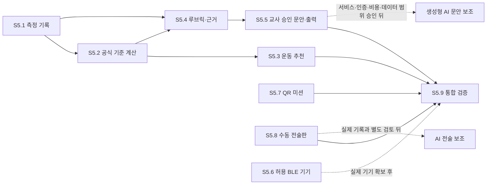

# S5 구현 계획: PAPS·과정평가·확장 모듈

2026-11-12 S5.7~S5.8 후속: 단발 GPS 도착 확인·안전 구역, 전술판 암호화 공유 서버, 로컬 Ollama 실제 경기 사례 찾기와 교사 검토 비교 기록 수집을 추가했다. 팀이 설명한 상황에 맞는 출처 사례를 찾아 보여주는 기능이며, 전술 정답 판정이나 학생 실행 지시가 아니다. [실행·범위·학습 준비](S5.7-S5.8-connected-guide.md)를 따른다. 외부 AI API 연결과 실제 모델 추가 학습은 수행하지 않았다.

2026-11-12 후속 변경: 아래 2026-11-07 상태에서 제외했던 40분 지속·발열·학교 현장 확인은 [교사의 첫 사용 점검](first-use-device-check.md)으로 전환했다. 앱에서 교사 PIN, 연속 촬영 시간, 수동 발열 관찰과 환경 체크리스트를 지원한다. 실제 기기 검증 완료 여부는 교사가 남기는 결과에 따른다.

2026-11-13 전술 사례 조사 방향 변경: 전술 설명 카드 수를 늘리는 계획에서 실제 경기 장면을 출처와 함께 수집·검색하는 계획으로 전환했다. 현재 카드 137개, 정규화 고유 출처 URL 103개, A/B/C 잠정 등급 95/37/5다. 농구·배구 각 20건 파일럿은 40/40건 대조를 마쳤다. 전체 감사는 기록된 범위에서 확인 136건, 부분 확인 1건(배구 33번), 미러 전용 0건, `PENDING` 0건이다. 피구 2번은 원 Tumblr permalink를 확인했고, 배구 18번은 경기 흐름 요약으로 좁혔다. 배구 33번은 공식 CEV 점수표로 late-set score checkpoint를 확인했으나 기사 안의 연속 득점 수 모순은 남아 있다. 배구 44번은 Newsis의 구체적인 2세트 흐름으로 대체했다. 연합뉴스의 AI 이용 제한이 있는 배구 42·43번은 runtime에서 제외되며 43번의 누락 플래그를 보완했다. 137개 모두 `draft`이고 이용 허가·교사/코치 승인 완료는 0건이다. 상세 상태는 [1차 감사 결과](tactics-case-audit.md), [카드별 감사 CSV](tactics-case-audit.csv), [파일럿 대기열](tactics-case-pilot-queue.csv)에 기록했다.

2026-11-17 S5.7~5.9 갱신: QR 스캔 실패 시 수동 경로, 화면 이탈 시 카메라·GPS 정리, 전술판 HTTPS 연결과 게시 복구를 [개발 환경에서 검증](stage-S5.3-S5.9-validation.md)했다. 카메라·GPS·학교 Wi-Fi 현장 확인 절차는 [지원 환경표](S5-support-matrix.md#s59-학교-기기-확인)에 있다.

상태: S5.1~S5.5, S5.7~S5.8의 로컬 개발 기능과 S5.9 자동 검증 완료. 2026-11-07 현재 S5.6은 PWA v2, Android 교사 태블릿 호스트, 학생 Android 휴대폰/Wear OS companion의 JVM 검사·APK 조립·Lint(0 오류·0 경고)를 통과했다. iPhone/Apple Watch Swift source scaffold와 프로토콜 검사를 추가했지만, Swift 테스트·Xcode 프로젝트 생성·macOS 빌드·서명은 환경에 Xcode가 없어 검증하지 못했다. Android 3개 APK의 실제 기기 설치, 공식 모델별 출시일/최소 휴대폰 OS 대조표와 실기기 연결도 남았다. 사용자는 학생별 페어링 휴대폰 → 같은 로컬 Wi-Fi → Android 교사 태블릿 경로를 선택했다. 학교 현장·발열·실제 40분 지속 검증은 이번 작업에서 제외했다. 자세한 근거·한계는 [S5.3~S5.9 검증 기록](stage-S5.3-S5.9-validation.md), [웨어러블 검증](stage-S5.6-wearable-validation.md), [공식 API 조사](stage-S5.6-vendor-api-research.md), [기기 적격성 표](S5.6-device-support-matrix.md), [LAN 릴레이 계약](S5.6-lan-relay-contract.md), [지원 환경표](S5-support-matrix.md)에 있다.

## 목표와 범위

첨부 「초등체육 에듀테크 및 앱 명세서」의 Fit-Track & PAPS, 운동 처방, Eval-Bridge & AI Scribe, Tactics & Bound Play 요구를 S3 학급·학생 식별자와 기존 PIN 암호화 저장 위에 순차 구현한다. 학생별 결과를 자동으로 채점·진단하거나 외부로 보내는 것을 기본값으로 삼지 않는다. 점수·평가 문구는 교사가 근거를 보고 수정·승인해야 한다.

문서에 제시된 1초 산출, 행정업무 80% 감소, 500개 콘텐츠 같은 수치는 달성 사실이 아니다. 구현 목표·효과 주장으로 쓰기 전 실제 업무와 자료를 이용해 따로 측정한다. 실제 NEIS 양식·PAPS 기준표·웨어러블 규격이 없는 경우 임의의 공식 기준이나 연동 완료를 주장하지 않는다.

## 의존 관계와 우선 순서

기본 순서는 S5.1 → S5.2 → S5.4 → S5.5다. S5.3의 자체 텍스트 루틴은 공식 기준과 연결하지 않는 교사 선택형 MVP로 구현했다. 기록된 PAPS 약점 자동 추론이나 개인 건강 처방은 제공하지 않는다. S5.7은 QR 전용 로컬 MVP로 독립 진행할 수 있다. S5.6은 PWA와 Android 세 모듈을 빌드했고, Apple iPhone/Watch Swift source scaffold를 추가했다. Apple Xcode 빌드·서명, 모델·OS 공식 전체 대조, 실물 LAN/워치 시험이 남아 있다. S5.8은 수동 전술판을 먼저 만들고 AI 기능을 분리한다. S5.9는 각 묶음에서 소규모 통합 검사를 하고 전체 흐름을 마지막에 다시 확인한다.

## 단계별 구현 묶음과 완료 기준

### S5.1 — PAPS 수기 기록

**S5.1.1 데이터 계약 — 구현:** `measurements` 원자료에 학년도, S3 학생 ID, 측정일, 종목 ID, 값/단위, 입력 시각, 미수정 표시를 분리해 저장한다. S5.2에서 교사가 별표 4 적용 학년군·평가표 구분을 직접 확인한 경우에만 기준 버전을 함께 저장한다. 결측은 null 값과 사유로 표현하고 0과 혼동하지 않는다. 종합점수·건강 판정은 저장하거나 계산하지 않는다. 기록은 입력 학년도를 포함해 최대 3개 학년도 보관하고, 세 번째 후속 학년도 3월 1일에 만료한다. 기록이 유효한 동안 해당 S3 학생 ID/이름과 학급 이름도 암호화 상태로 유지하며 마지막 연결 기록 만료 또는 교사의 학급 삭제 때 정리한다. PAPS 자료는 기존 7일 클립 만료와 outbox/허브 전송 대상에서 분리했다.

**S5.1.2 교사 입력 — 구현:** 학급별 학생 ID 선택, 학년도/측정일, 수기 종목의 단위·기술 입력 범위·정밀도를 검사하고 다음 학생으로 이어 입력할 수 있게 했다. 현재 14개 입력 항목은 왕복오래달리기, 앉아 윗몸 앞으로 굽히기, 윗몸말아올리기, 제자리멀리뛰기, 악력, 50m 달리기, 오래달리기-걷기 1,000/1,200/1,600m, 스텝검사 PEI, 팔굽혀펴기, 무릎대고 팔굽혀펴기, 종합유연성, BMI다. BMI는 키·몸무게 원자료를 입력하고 별표 3 기록법으로 계산한다. 미측정·결시·수행 불가·중단/거부·측정 오류·기타를 결측 이유로 제공한다. 범위와 자릿수는 오입력 방지용 기술 한계이며, 별표에 없는 값에 공식 판정을 만들지 않는다. 잘못 입력한 행은 PIN 안에서 개별 삭제 후 다시 입력할 수 있다. 음성 입력과 BLE 자동 입력은 후속 검증 뒤에 둔다.

**S5.1.3 변경·삭제 — 구현:** 교사가 값을 수정하면 이전 값·새 값·시각·교사 역할을 같은 PIN 암호화 기록에 추가하고 마지막 수정 시각을 갱신한다. 입력 시각은 보존한다. 학생 ID와 학년도는 수정할 수 없고, 잘못된 식별은 해당 기록을 지운 뒤 다시 입력한다. 개별 기록 삭제와 학급 삭제는 원값과 해당 수정 이력을 함께 제거한다. 학년도 만료도 nested history를 남기지 않는다. PIN 초기화는 IndexedDB의 클립과 암호화 학급 메타데이터를 새 PIN 설정과 한 트랜잭션에서 교체하며, 취소·실패는 기존 자료를 보존하고 성공하면 측정값과 수정 이력까지 지운다. 교사별 계정이 없는 현재 구조에서는 변경 주체를 `teacher` 역할로만 남긴다.

**현재 판정:** S5.1 전체 개발 구현·검증 완료. 실제 학교 자료·운영 정책 검토는 별도다. 공식 점수 계산은 S5.2에서 출처가 확인될 때까지 하지 않는다.

### S5.2 — 공식 PAPS 기준·계산·리포트

**S5.2.1 기준표 등록 — 구현:** 사용자가 제공한 공식 PDF 별표 4의 남녀·학년 종목 등급 기준 176개 행과 BMI 분류 20개 범위를 등록했다. 별표 4 등급표는 13종목이고, BMI는 별도 분류표에서 초3~고3 남녀 구간을 제공한다. 오래달리기-걷기는 16개, PEI 16개, 남자 팔굽혀펴기 6개, 여자 무릎대고 팔굽혀펴기 6개, 남녀 종합유연성 각 6개 기준이다. 팔굽혀펴기 두 종목과 종합유연성은 중·고등학교 범위만 등록하고, 성별별 팔굽혀펴기 방법도 구분한다. 적용하지 않는 학년·성별 조합은 등록하지 않는다. 항목은 출처 문서/해시/쪽수, 시행일, 학년도, 학년군, 단위, 대상 구분을 보유한다. 이름·성별·연령을 추정하지 않으며 대상 구분 확인 없이는 기준을 조회하지 않는다. 출처 범위와 법적 한계는 [S5.2 출처 기록](S5.2-criteria-sources.md)에 있다.

**S5.2.2 종목별 등급·항목점수·BMI 구간 조회 — 구현:** `paps-criteria.js`는 기준 범위 양 끝을 포함해 13종목별 등급과 별표 5의 20점 만점 항목점수를 반환하고 별표 4 각주대로 끝 범위 밖 값을 끝 등급에 둔다. 점수는 각 등급 구간을 같은 수의 측정 단위로 나눠 점수 구간에 배정하며 최소/최대와 기록 방향을 적용한다. 종합유연성은 별표 5의 고정 4·8·12·16·20점을 쓴다. `paps-bmi-criteria.js`는 별표 4의 BMI 표를 학년·평가표 구분별 참고 분류로 적용한다. BMI 입력에서는 키·몸무게를 받아 별표 3에 따라 0.1 kg/m² 단위로 올림 계산하고 두 원값과 기준 버전을 PIN 암호화 기록에 보존한다. 별표에서 과체중/경도 비만 구간이 병합된 남학생 고2·고3은 하나의 통합 구간으로 표시한다. 교사가 학년·평가표 구분을 직접 선택하며 학생 이름·성별·연령을 추정하지 않는다. 등급 기준은 현재 176행, BMI 분류는 20범위의 경계를 검증했다. 별표 1의 성별·연령별 BMI 백분위 기반 건강검사 판정, BMI 점수와 5요인 종합점수는 세부 산식/선택 방식이 미확정이라 미산출한다. 의료 진단도 제공하지 않는다.

**S5.2.3 출력 — 구현·로컬 검증:** 학생 추이는 교사가 학생·종목·별표 4 학년·평가표 구분을 직접 골랐을 때 실제 입력 기록만 연도순 그래프/목록에 표시한다. 종목별 점수는 기록된 등급 기준 범위로 다시 계산하고 항목점수 산식 버전도 표시한다. 학급 분포는 교사 PIN 영역에서 학년도·종목·학년·평가표 구분·저장된 기준 버전이 맞는 수치만 분류하며 결측과 다른 기준/미분류는 별도로 센다. PAPS CSV는 학생과 원자료를 각각 선택하고 확인을 거쳐 내려받으며 등급·항목점수·산식 버전을 담는다. CSV 수식 시작 문자는 무력화하고 줄바꿈을 한 셀 안에서 정리한다. 공식 NEIS 양식·백분위·BMI 점수·5요인 종합점수는 제공하지 않는다.

**S5.2.4 50m 달리기 — 구현·로컬 검증:** 별표 3의 0.01초 입력과 별표 4 남녀·초3~고3 20개 기준 행을 추가했다. 등급 판정은 기록이 짧을수록 높은 등급이며 양 끝 범위 밖은 각주대로 가장 낮거나 높은 등급으로 처리한다. 기존 입력·저장·수정 이력·추이·분포·선택형 CSV 흐름을 재사용한다. 상세 출처·경계 검사와 Chromium 화면 검사는 [S5.2.4 검증 기록](stage-S5.2.4-50m-validation.md)을 따른다.

**S5.2.5 오래달리기-걷기·스텝검사 — 구현·로컬 검증:** 별표 3의 거리별 실시 범위와 스텝박스 높이/속도, 별표 4의 오래달리기-걷기 16개 적용 기준과 PEI 16개 적용 기준을 추가했다. 시간은 분:초를 총 초로 입력하며, 측정 학년·평가표 구분을 직접 선택해 거리와 실시 가능 여부를 확인한다. PEI는 학교가 규정에 따라 산출한 최종 점수만 입력하며 앱은 심박수를 수집·저장하거나 PEI를 계산하지 않는다. 입력 범위·프로토콜 안내·별표 4 등급·측정 범위와 거리의 암호화 보존·CSV 출력을 확인했다. 상세 내용은 [S5.2 출처 기록](S5.2-criteria-sources.md)과 [S5.2.5 검증 기록](stage-S5.2.5-runwalk-pei-validation.md)을 따른다.

**S5.2.6 팔굽혀펴기·종합유연성 — 구현·로컬 검증:** 별표 3의 남자 팔굽혀펴기와 여자 무릎대고 팔굽혀펴기 방법, 종합유연성 4개 영역의 좌우 점수법을 안내한다. 별표 4에서 팔굽혀펴기 두 종목은 각각 해당 중·고 평가표 6개, 종합유연성은 남녀 중·고 12개 적용 기준을 등록한다. 종합유연성 원점수는 0~8점이며 등급 경계는 4점 이하·5·6·7·8점이다. 상세 내용은 [S5.2 출처 기록](S5.2-criteria-sources.md)과 [S5.2.6 검증 기록](stage-S5.2.6-pushups-flex-validation.md)을 따른다.

**S5.2.7 BMI 계산·별표 4 구간 — 구현·로컬 검증:** 별표 3의 키·몸무게 이용 BMI 계산과 0.1 kg/m² 올림 기록법, 별표 4 PDF 19쪽 남녀·초3~고3 20개 BMI 범위를 추가했다. 학생 본인과 보호자의 동의를 각각 확인해야 BMI를 미리 계산하거나 저장하며, 동의 확인은 기록하지 않는다. 화면에서 키·몸무게를 입력하면 BMI와 해당 PAPS 구간을 미리 보고 저장한다. 보고에는 실제 입력 추이·같은 범위의 구간 분포·확인형 로컬 CSV를 포함한다. 남학생 고2·고3 표의 병합된 과체중·경도 비만 칸은 통합 구간으로 유지한다. 별표 1의 성별·연령별 BMI 백분위수 건강검사 판정, 의학적 진단, PAPS 종합점수는 계산하지 않는다. 근거·경계와 검증은 [BMI 검증 기록](stage-S5.2.7-bmi-validation.md)에서 확인한다.

**S5.2.8 별표 5 항목점수 — 구현·로컬 검증:** 별표 5 PDF 20쪽의 20점 항목 점수 환산을 등급 구간별로 균등 분할해 종목별 점수로 표시한다. 별표의 정수 예시와 같은 분할·반올림 동작을 검사했다. 종합유연성은 별도 고정값(5→4, 4→8, 3→12, 2→16, 1→20)을 적용한다. 이 항목점수는 다섯 체력요소를 합친 종합점수가 아니다. BMI 점수와 종합점수는 정확한 세부 규정이 필요해 미산출한다. [S5.2.8 점수 검증 기록](stage-S5.2.8-item-scores-validation.md)을 따른다.

**S5.2.9 체력요소별 검사 선택 — 구현·로컬 검증:** 제7조제3항과 별지 제1호서식의 체력요소-검사항목 집계를 반영해 학급·학년도·학년별 한 종목씩 설정한다. 오래달리기-걷기 거리와 남녀 팔굽혀펴기 변형은 직접 고른 평가표 기준으로 실제 측정 종목에 연결한다. 설정은 PIN 암호화 저장소에 보관하고, 선택 변경 시 이전 설정을 이력에 남기며 입력 학년도와 같은 3개 학년도 만료 규칙을 적용한다. 점수 계산은 하지 않는다. BMI 점수 세부 배점이 법령에 없어 100점 합계·종합등급은 미제공이다. [S5.2.9 설정 검증 기록](stage-S5.2.9-paps-factor-selection-validation.md)을 따른다.

**S5.2.10 나이스 공식 자료 조사 — 공개 원문 대조 완료:** 별표 5의 정상 BMI 20점 및 5요인 합산, 별표 6의 100점 종합등급 구간, 나이스 매뉴얼의 종목별 백분위 조회와 일괄입력 절차를 확인했다. 정상 밖 BMI 세부 배점, 종합 결측 처리, 백분위 기준 모집단·산식 및 실제 파일은 확보되지 않았다. 현재 앱은 BMI 구간과 개별 종목 점수·분포를 제공한다. [공식 자료 대조와 필요한 자료](S5.2-S5.5-official-data-audit.md)

**완료:** 출처가 고정된 모든 구현 기준표의 표본 계산을 독립 대조하고 경계 테스트가 통과한다. 1초 성능 주장은 재현 가능한 시간 측정 뒤에만 한다.

**S5.2.3 검증:** 순수 보고 함수의 기록 범위·등급 분포·수식 삽입 경계를 단위 검사했고, 실제 Chromium 브라우저에서 선택 등급 보고와 확인형 CSV 다운로드를 확인했다. 다년 실제 자료가 없어 실제 여러 학년도의 추세·변화 해석은 검증하지 않았다.

### S5.3 — 맞춤 운동 콘텐츠와 15분 루틴

**S5.3.1 콘텐츠 목록 — MVP 구현:** 자체 작성한 저작권 미디어 없는 6개 텍스트 안내를 안정 ID·목표 요소·난이도·시간·도구·주의와 함께 등록했다. 항목은 `teacher-review-required`이며 교사가 안전 주의와 이 학급의 공간/연령 적합성을 각각 직접 확인하기 전에는 루틴에서 선택할 수 없다. 전문가 안전 검토·교육청 승인·개별 학생 적합성 판정 완료를 뜻하지 않는다.

**S5.3.2 첫 루틴 — 구현·검증:** 교사 검토된 동작 하나씩을 스트레칭 3분 → 근력 6분 → 이동 6분으로 조합하는 900초 플레이어를 연결했다. 교사는 목표 요소별 후보를 보고 직접 선택하며 일시정지·재개·건너뛰기·같은 구간의 승인 대체 동작을 쓴다. 루틴 이력이나 학생별 건강 분류는 저장하지 않는다.

**S5.3.3 목표 후보 — MVP 구현:** 교사가 유연성·근력·지구력·협응 목표를 골라 해당 요소를 포함한 검토 완료 동작을 후보로 본다. 이는 기록 기반 개인 처방이 아니며 자동 비만 진단·건강 낙인·치료 처방을 하지 않는다. 500개 미디어 콘텐츠는 제공하지 않는다.

**완료·한계:** 900초 타이머·교사 승인·대체/건너뛰기를 브라우저와 단위 검사로 확인했다. 텍스트만 포함하고 외부 미디어·콘텐츠 사용권을 주장하지 않는다. 실물 수업 안전 검증은 남아 있다.

### S5.4 — 성취기준·과정 평가·교사 루브릭

**S5.4.1 루브릭과 성취기준 연결 — 구현:** 학년도·지식/기능/태도 기준·4수준 설명을 교사가 만들고 바꿀 수 있다. 변경은 버전·이력에 남고 각 평가에는 생성 당시 루브릭을 보존한다. 2022 개정 체육과 별책 11의 초등 3~6학년과 중학교 성취기준 100개 중 학년과 학년도에 맞는 기준을 교사가 선택하고 출처를 평가에 남길 수 있다. [출처 및 사용법](S5.4-pe-curriculum.md)

**S5.4.2 근거 연결 — 구현:** 같은 학급·학생 소유의 교사 관찰, 학생 성찰, 학생이 직접 제출한 클립 ID만 골라 연결한다. 클립 원본을 평가에 복제하지 않는다. 자동 동작 이벤트·PAPS 체력값은 평가 근거로 연결하지 않는다. 자료 없음은 미평가로 두며 0점으로 바꾸지 않는다.

**S5.4.3 승인 흐름 — 구현:** 교사가 수기 수준과 서술·근거를 편집하고 모든 항목을 채운 뒤 별도로 승인한다. 수정하면 승인 상태가 초안으로 돌아가며 역사 버전을 기록한다. 연결 평가가 수정되면 이를 근거로 한 승인 문안도 자동 초안으로 내려간다.

**완료·한계:** 학생 경계·근거 형식·수준 범위·수정과 재승인·루브릭 버전 보존·삭제·만료 및 성취기준의 학년 적용 검증과 당시 출처 보존을 자동 검사했다. 학교의 실제 수업 배치와 평가 계획은 교사가 확인한다.

### S5.5 — 교사 승인 문안·파일 출력

**S5.5.1 근거 모음 — 구현:** 교사가 같은 학생의 승인 평가만 직접 선택하고, 문안에 연결된 평가 ID를 확인한다. 승인 기록 바깥 문장을 자동으로 만들지 않는다.

**S5.5.2 수동 초안 — 구현:** 제목·문장을 교사가 직접 작성/수정한 뒤 근거 평가와 별도로 승인한다. 생성형 AI는 포함하지 않는다.

**S5.5.3 문안 분량 참고·임시 출력 — 구현:** 2026학년도 문안에서 고교 과목별 세특의 1,500바이트 기준과 현재 UTF-8 추정 분량을 표시한다. 한 학생의 승인 문안만 선택 후 확인 창을 거쳐 로컬 CSV로 다운로드한다. 수식 시작 문자를 무력화하고 줄바꿈을 셀 안에서 정리한다. 나이스 실제 파일의 열 구조와 업로드는 미검증이다. [현행 근거 및 양식 확인 범위](S5.2-S5.5-official-data-audit.md)

**완료·한계:** 한 학생 범위와 승인 상태를 코드에서 재검사해 초안·다른 학생·수정된 원 평가 문안 내보내기를 거부함을 단위 검사에서 확인했다. 실제 행정 양식은 미검증이다.

### S5.6 — 웨어러블·스마트 교구 시범 연결

**상태 — Android 구현·자동 검사 완료, iOS/watchOS 소스 추가·빌드 미검증, 실기기 확인 대기:** 2026-11-07 기준 4년 이내 출시한 Apple Watch/Galaxy Watch를 목표로 한다. 웹앱에는 심박 전용 세션, 학생·보호자 동의 게이트, 연결 초대 QR, 오래된 값 숨김, 연결 공백 표시, 워치 단절 시 교사 재연결, Wi-Fi 복구 시 새 표본부터 이어지는 상태를 구현했다. Android 태블릿 앱은 출처 제한 WebView, TLS LAN 수신기, 일회용 QR, RAM 전용 재접속 자격, DNS-SD 재광고를 포함한다. 학생 Android 앱은 QR/TLS 연결·NSD 탐색·백오프 재시도 및 Wear 메시지 전달을, Wear OS 앱은 `ExerciseClient` HR capability·권한 검사와 현 연결 토큰으로 묶은 심박 전달을 포함한다. iPhone/Apple Watch에는 동일 QR/TLS·Bonjour·HealthKit/WatchConnectivity 경로의 Swift source scaffold와 Swift Package 검사를 추가했지만, 이 Linux 환경에 Swift/Xcode가 없어 실행·프로젝트 생성·서명은 확인하지 않았다. Android 전체 Gradle 검사에서 11 JVM 단위 사례·세 APK·Lint 0 오류/0 경고가 통과했다. 태블릿·휴대폰·워치 설치와 실 LAN 연결, Apple macOS 빌드/실기기 시험, 공식 모델별 출시일/최소 OS 전체 대조는 남았다.

**S5.6.1 공식 API 선택·기기 적격성 표 — API 경계 정리, 잠정 후보 목록, 공식 대조 미완료:** Apple은 watchOS `HKWorkoutSession`/`HKLiveWorkoutBuilder`와 페어링 iPhone 앱 통신을, Galaxy는 Wear OS 3 이상 Health Services `ExerciseClient`를 사용한다. 실제 Wear 앱은 `WORKOUT` 운동 유형의 `HEART_RATE_BPM` 기능과 권한을 매번 확인한다. Samsung Health Sensor SDK의 Watch4 이상 표기는 API 범위일 뿐 4년 출시일 기준이 아니다. [S5.6 기기 적격성 표](S5.6-device-support-matrix.md)에 API 하한·2022-11-07 출시일 조건·코드에 둔 잠정 Galaxy 모델 allowlist·지원 상태 전환 기준을 정리했다. 공식 모델 ID/출시일·최소 페어링 휴대폰 OS의 완전한 대조 및 실물 연결 전에는 특정 모델을 지원한다고 표시하지 않는다. 권한 요청은 학생 companion에서 처리한다.

**S5.6.2 단일 기기 MVP:** 첫 데이터 범위는 수업 중 심박수(bpm)·시각·신선도다. 이 값은 실시간 화면 메모리에만 두고 로컬 클래스 저장소·허브·외부 서비스에 쓰지 않는다. 학생·학급·시계 식별자는 네이티브 브리지로 보내지 않는다. 학생과 보호자 동의가 매 수업에서 모두 확인되어야 연결 초대를 만든다. Android 휴대폰 companion은 초대를 읽고 TLS 지문 고정으로 태블릿에 연결한다. Wear OS와 Apple Watch companion은 각각 Health Services와 HealthKit에서 심박만 읽도록 소스를 추가했으며 유효한 현 수업 토큰에 묶는다. Android APK 설치/실행, Apple Xcode 빌드/서명 모두 미검증이다.

**S5.6.3 안전·실패 경계:** 이 MVP에서는 칼로리·위치·수면·건강 진단·위험 경보·자동 채점은 수집/제공하지 않는다. 학생 또는 보호자 동의 철회·OS 권한 철회·페이지 잠금은 수집을 중단하고 화면의 값을 지운다. 연결이 끊기거나 OS 권한이 거부돼도 수업은 제한하지 않는다. 측정값은 숨기고 이 세션의 심박 기록을 비워 둔다. 워치 연결은 교사가 수동 재연결하고, 로컬 Wi-Fi 연결은 휴대폰이 같은 태블릿 호스트로 자동 재시도한다. 자동 복구 전까지 기록 공백을 유지하며, 수신 대기열로 공백 데이터를 채우지 않는다. 심박수는 운동 중지 판정으로 쓰지 않는다.

**S5.6.4 휴대폰-교사 화면 데이터 경로 — 로컬 구현 완료:** 사용자가 학생별 페어링 휴대폰 → 같은 로컬 Wi-Fi → Android 교사 태블릿 네이티브 호스트를 선택했다. Android 호스트는 일회용 티켓·TLS 지문·RAM 재접속 자격·DNS-SD 재광고를 포함한다. 학생 Android 앱은 NSD 서비스 탐색·백오프 재시도·실패 시 새 QR 안내를 구현했고, 연결마다 새 워치 세션 토큰을 써 이전 연결에서 늦게 도착한 메시지를 거부한다. PWA는 복구 뒤 새 표본만 표시한다. 자동 검사는 통과했지만 태블릿 설치·LAN 실연결·실제 IP 변경은 아직 확인하지 않았다.

**완료·대기:** 기존 브리지 v2, Android 태블릿 호스트, Android 학생 휴대폰/Wear OS companion은 단위 검사와 APK 조립/Lint를 마쳤다. Apple iPhone/Watch Swift source scaffold와 플랫폼 중립 프로토콜 테스트도 추가했다. Apple 프로젝트 생성·Swift 검사·macOS 빌드/서명, 세 Android APK 설치와 모든 기기의 실 LAN 연결은 검증되지 않았다. 공식 모델별 출시일·OS 대조, 연결/권한 실패·기기 재시작·표본 단위·시계 오차·오래된 값·ambient 동작은 실제 모델에서 확인해야 한다.

### S5.7 — QR 미션·퀴즈와 오프라인 재개

**S5.7.1 교사 제작 — 구현:** 교사가 제목·순서 활동·선택 퀴즈·모둠을 로컬에서 만들고 QR을 생성한다. QR payload는 무작위 미션 UUID 하나뿐이다. 교사가 정답을 입력해도 학생 화면에는 정답을 공개하지 않는다.

**S5.7.2 학생 흐름 — 구현:** BarcodeDetector가 있으면 카메라 QR 읽기를 시도하고 미지원/권한 없음 때 UUID 직접 입력으로 대체한다. 순서 활동·퀴즈 답·일시정지·재개·다시 시작·동일 응답 ID 재시도를 처리한다. 익명 모둠/세션 ID만 저장하고 학생 이름/ID는 응답에 연결하지 않는다.

**S5.7.3 오프라인 우선·GPS — 구현:** 미션/세션/응답은 PIN 암호화 저장한다. 첫 활동에 목표·안전 구역과 반경을 정하고, 명시적 일회성 위치 요청으로 신선도·GPS 정확도·구역 내부 도착을 확인한다. 실제 위치는 저장/전송하지 않고 도착 확인만 응답에 남긴다. GPS 미션의 기기간 진행 동기화는 포함하지 않는다.

**완료·검증:** 오프라인 브라우저 시나리오에서 수기 UUID 참여·2단계 진행·퀴즈 평가·암호화 저장을 확인했다. 단위 검사에서 중복 응답 ID 멱등성, 잘못된 학급 참조, pause/resume/restart, serialization을 검사했다. 실물 카메라 QR 센서 검증은 하지 않았다.

### S5.8 — 수동 전술판과 후속 AI 보조

**S5.8.1 전술판·공유 — 구현:** 좌표 입력으로 익명 토큰·이동/패스 화살표·공격/수비 표식을 편집하고 스냅샷·회고를 PIN 암호화 저장한다. 별도 서버에 익명 도형 배치만 AES-GCM 암호문으로 공유하고 SQLite 영속 저장·읽기/편집 초대·24시간 만료·버전 충돌 거부·공유 종료를 지원한다. 최신 공유 배치는 로컬 수정본을 보존하고 새 판으로 가져온다. 실시간 자동 병합은 아니다.

**S5.8.2 회고 — 구현:** 계획/실행/다음 개선 문장을 직접 입력한다. 알려진 학생 이름·번호·내부 ID를 포함하면 거부한다. AI 판정 없이 저장한다.

**S5.8.3 로컬 LLM — 출처 사례 탐색 구현, 조사 계획 개정:** 현재 팀 요청·익명 배치·종목·비교 관점을 서버가 로컬 용어 검색에 사용해 A/B·사실 확인 완료 사례 중 후보 최대 8개를 찾고 같은 서버 컴퓨터의 Ollama에 전달한다. 명시적 AI 제한·부분 확인·C 등급은 검색에서 제외하고, 같은 출처 후보는 최대 2개로 제한한다. 모델은 후보에서 최대 3개를 선택하며 후보가 없으면 호출하지 않는다. 이 RAG 경로는 로컬 키워드/한글 bigram 점수화이며 임베딩이나 가중치 학습은 아니다. 모든 사례가 `draft`이고 출처 권리도 확인되지 않아, 교사 승인 게이트와 이용 조건 확인은 남아 있다.

런타임 카드는 농구 44·배구 45·축구 30·티볼 8·피구 10, 총 137개이며 모두 `draft`다. 현재 조사 계획은 전술명이 아니라 실제 경기 장면을 검색 단위로 삼는다. 현재 카드 137개와 103개 고유 출처 URL은 서로 다른 경기·장면 수가 아니므로 재사용 가능성을 감사한 뒤 추가 조사한다. 첫 시범은 농구·배구 각각 20개 검토 후보 장면을 운영 목표로 삼으며 과학적 최소 수로 보지 않는다. 다른 종목은 규칙·연령·대회 맥락이 확인되는 자료만 보강한다. 기존 축구 용어 참고와 티볼·피구 경기 회고는 배경 자료/장면 후보로 분리해 검토한다. 검색 평가 질문, 교사·코치 검토 자료, 경기 카드 카탈로그는 별도로 관리하며 검색 기록은 자동 학습하지 않는다. 자세한 단계와 출처 기준은 [실제 경기 사례 중심 조사 계획](tactics-case-research-plan.md)을 따른다. 검토 비교 기록은 저장·내보낼 수 있지만, 현재 카드의 내용 감사·교사 승인·가중치 추가 학습·현장 전술 정확도 검증은 아직 수행하지 않았다.

**완료·한계:** 기존 로컬 기능에 더해 공유 암호화·권한·충돌·복구·만료, 두 격리 브라우저의 공유와 모의 로컬 모델을 검사했다. 실제 학교 네트워크·기기간 연결·Ollama 모델 생성 품질·교사 참고자료 검토는 남아 있다.

### S5.9 — 통합·지원 환경 검증

**S5.9.1 모듈 회귀 — 로컬 개발 검증 완료:** PAPS 측정·등급·보고 CSV, 루틴 검토·15분 타이머, 평가 근거·승인·문안 CSV, 오프라인 QR 응답, 전술판 저장/삭제, 동의 게이트가 있는 가상 웨어러블 브리지, PIN 저장과 서비스워커 캐시 회귀를 브라우저/단위 테스트했다.

**S5.9.2 지원표 — 개발 환경 기록:** 실제 시험한 Chromium 가상 환경과 미실행 OS/실물 환경, BarcodeDetector/수동 ID 대체 경로, 테스트용 웨어러블 브리지와 미실행 네이티브/BLE 연결을 분리해 [지원 환경표](S5-support-matrix.md)에 기록했다.

**S5.9.3 운영:** PAPS·평가 CSV는 교사 확인형 로컬 임시 출력이며 NEIS·클라우드 전송이 아니다. 학급 삭제·만료·PIN 초기화는 민감 모듈 데이터와 함께 정리된다. 서비스워커 v21 캐시 갱신을 검사했다. 백업/복구 또는 외부 동기화는 제품 기능으로 연결하지 않았다.

**완료 판정:** 로컬 코드/저장/삭제/오프라인 기능은 자동 검증했다. 실물 기기·현장 환경·조직 정책이 필요한 항목은 남아 있으므로 S5 전체 릴리스 검증 완료로 표시하지 않는다. Android·학교 현장·발열·실제 40분 연속 실행은 이번 사용자가 제외한 범위라 실행하지 않았다.

## S5 착수 순서와 비용 절감

1. **S5.1·S5.2 기반:** S3 ID와 PIN 암호화 저장 위에 3개 학년도 PAPS 보관, 2026 별표 4 개별 종목 기준·직접 선택·보고를 구현했다. 합산과 종합등급 기준은 확인했다. BMI 세부 배점·종합 결측 처리와 나이스 백분위 산식은 확인이 필요하다.
2. **S5.3~S5.5 교사 검토/승인:** 자체 텍스트 루틴과 교사 루브릭, 2022 개정 체육 성취기준, 2026 고교 과목별 세특 분량 참고를 연결했다. 콘텐츠 전문가 승인과 실제 나이스 양식의 호환 검증은 남아 있다.
3. **S5.7~S5.8 확장:** GPS 단발 도착·전술판 암호화 공유·로컬 LLM 연결과 학습 예제 수집을 구현했다. HTTPS 공유 서버 배포·실물 GPS/기기간 시험·모델 설치와 실제 품질 검토/추가 학습은 남는다.
4. **S5.6 및 외부 AI/공식 출력:** 기기 모델·허용 규격·실물 시험/동의, AI 서비스 범위·인증·비용, 실제 NEIS 샘플이 제공되면 별도 개발 단계로 연다.
6. **검증 비용:** 단독 변경은 Sol이 관련 테스트를 끝내고, 공식 기준/민감 데이터 경계에서만 Terra 또는 Luna의 좁은 독립 검토를 붙인다. 전체 회귀는 통합 시 한 번 실행한다. 상세 배분은 [토큰 효율별 팀 기준](session-goals.md#남은-작업의-토큰-효율별-배분)을 따른다.

## 원문 요구와 제품 완료 판정의 구분

첨부 명세서의 1초 계산, 업무 80% 절감, 500여 개 영상, 실시간 심박 위험 경보, 자동 NEIS 파일/생기부 생성, 다기기 BLE, GPS/메타버스 요구는 자료·기기·공식 규격·개인정보 검토가 필요한 제안이다. 현재 제품 기능이나 검증 근거로 취급하지 않는다. S5는 작은 검증 가능한 흐름부터 구현하고, 공식 출처·동의·실물 기기 또는 실제 업무 측정이 확보되지 않은 항목은 독립된 “대기”로 기록한다.
